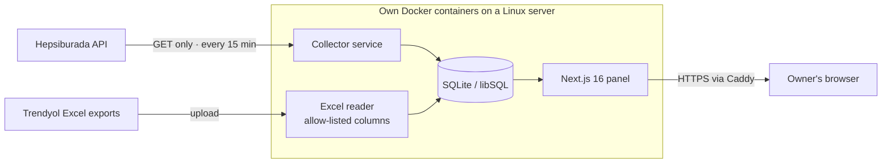

# Fermente Paneli

**Sales, profit, payout-audit and customer-question dashboard for a brand selling on Trendyol and Hepsiburada**

Black Wool Project · **Project Lead & Developer** · [Türkçe](README.tr.md)

> **About this repository.** Fermente Paneli is built at Black Wool for **Fermente Mutfağım**, a
> fermented-food and natural-care brand that sells on Trendyol and Hepsiburada. Its source code is
> private; this is a case study. Screenshots were taken from the running system on 28 Oct 2026;
> revenue, amounts and order numbers are covered with solid boxes.

---

## At a glance

| | |
|---|---|
| **Client** | Fermente Mutfağım — fermented foods and natural care products, sold on two marketplaces |
| **What it is** | A **read-only** reporting panel: it never changes prices, stock or listings on either marketplace |
| **Screens** | Overview · Orders & returns · Products · Finance (payout audit, payments, advertising, rules) · Customer questions |
| **Data in** | Hepsiburada API every 15 minutes · Trendyol daily Excel exports · product cost template |
| **Scale** | This month 601 orders; payout audit checks every order line against the marketplace's own deductions — 614 orders in October, 29 flagged |
| **Codebase** | 21 models · ~5,700 lines of TypeScript in the app · 371 commits · 11 test files |

Measured from the repository and the running panel on 28 Oct 2026.

---

## The problem

The brand's owner sells the same products on two marketplaces, each with its own seller portal,
its own reports and its own way of deducting commission, shipping, service fees and advertising
from the payout. Answering simple questions — *How much did we sell yesterday? What will actually
land in the bank? Did the marketplace deduct what it should have? Is there a customer question
waiting?* — meant logging into both portals and downloading spreadsheets.

The owner needed **one screen for both marketplaces**, and a way to catch payout deductions that do
not match the marketplace's own rules — without giving a new tool any power to change anything in
the shops.

## What I built

| Screen | What it shows |
|---|---|
| **Overview** | Revenue, orders, units and basket size for a chosen day, a 7-day revenue chart split by marketplace, a live "today" box, and an attention list (e.g. *product costs not entered*) |
| **Orders** | Every order from both marketplaces with products, city, carrier and status; returns in a separate tab; Excel export |
| **Products** | Products and bundles with their contents, and a downloadable cost template so profit can be calculated |
| **Finance · payout audit** | Each deduction the marketplace made is compared with what its own rules predict; mismatching orders are flagged with the reason |
| **Finance · payments & ads** | When money will be paid, and advertising cost per period |
| **Customer questions** | Questions from both marketplaces in one inbox, median answer time, questions that expired unanswered, and questions **flagged as health-related** so the owner answers those personally |

### In progress

| Feature | Status |
|---|---|
| **Answering questions from the panel** | Being built now. The question inbox is on the server; sending the answer to Hepsiburada and Trendyol is the next step, with both APIs' answer endpoints already checked against their official documentation |
| **Morning summary e-mail** | Planned as the third part of the system next to the panel and the collector: every morning at 08:00 the owner receives yesterday's summary, with numbers identical to the panel's; the admin copy carries a health line (collector's last run, orders and questions received) |

---

## Screens

<table>
<tr>
<td width="50%"> <b>Payout audit.</b> 614 orders checked this month: 475 match every rule, 36 are explained (return, cancellation), 74 are waiting for the marketplace's record, 29 need attention. Amounts and reasons masked.</td>
<td width="50%"> <b>Customer questions.</b> One inbox for both marketplaces, with the data freshness of each source shown at the top; health-related questions are flagged for a personal answer.</td>
</tr>
<tr>
<td colspan="2"> <b>Orders.</b> Both marketplaces in one list with status counts; order numbers and amounts masked. No customer names are stored — see below.</td>
</tr>
</table>

---

## Architecture

The panel and the collector are **two services built from the same image**: the collector pulls
data, the panel only reads the database. A nightly backup job runs on the server.

---

## Engineering decisions

### 1. Read-only by construction

The collector calls only `GET` endpoints of Hepsiburada's order, accounting and question services;
no endpoint that writes, answers or reports anything is ever called. Response bodies are never
logged — the log holds only counts, endpoint names and HTTP status — and API keys come from the
environment and are never printed.

### 2. No customer personal data, enforced at two doors

The data model's first rule is that **buyer personal data never enters the database**. The collector
keeps only non-personal fields from each order. The Excel reader writes only columns that appear in
an explicit allow-list — if an export ever contains an unexpected column, the import **stops**
instead of storing it, so a changed or broken export cannot leak a personal field into the panel.
Imports run in a single transaction: all rows or none.

### 3. Profit uses the marketplace's numbers, not ours

Profit = what the marketplace will pay − product cost − shipping. Deductions are **not
recomputed** from rules; they come from the marketplace's own records (Trendyol's order ledger,
Hepsiburada's accounting service). Until Hepsiburada posts its record, the payout is estimated from
the order's commission and shown as *not final*. If a product has no cost entered, the order shows
*no cost* rather than a made-up profit. Where Hepsiburada already includes a shipping share in its
deduction, the manual shipping cost is not applied again — measured on 3,070 Hepsiburada orders.

### 4. The audit explains, it does not accuse

Every deduction is compared with the amount the marketplace's own rules predict. Orders split into
*matches*, *explained* (return or cancellation), *waiting for the record* and *needs attention*;
each flagged order carries the reason in words. The panel only points; disputes are filed in the
marketplace's own portal.

### 5. Advertising cost from cumulative snapshots

Trendyol's ad report is cumulative from the campaign's start to the moment of download, and its
date filter does not split the figure by period (measured). The panel therefore stores each upload
as a snapshot and computes a period's cost as *last snapshot before the period ends − last snapshot
before it starts*.

### 6. A pinned database engine

Prisma downloads its schema engine from its own server, outside the npm supply chain. A wrapper
script verifies the engine's SHA-256 against a pinned value and **stops** on mismatch; any further
download attempt is pointed at an unreachable address so it fails loudly. Passwords are hashed with
Node's built-in scrypt — no extra dependency.

---

## Tech stack

| Layer | Technology |
|---|---|
| App | Next.js 16, React 19, TypeScript, Prisma ORM 7, SQLite via libSQL |
| Data in | Node collector (Hepsiburada REST, GET only), Python Excel reader with allow-list |
| Quality | Node test runner (11 test files in `src/lib`), Python unit tests for the Excel reader |
| Delivery | Docker, GitHub Actions → GHCR, Caddy, nightly backup |

---

## My role

I built the panel at Black Wool, which manages the brand's marketplace operations: requirements
with the owner, screen designs approved before building, the data model, the collector and Excel
reader, the profit and payout-audit logic, and deployment to the server in stages, each released as
a tagged build.

## What is not in this repository

Source code, API keys, the panel's address, revenue, amounts, order numbers and any customer data.
