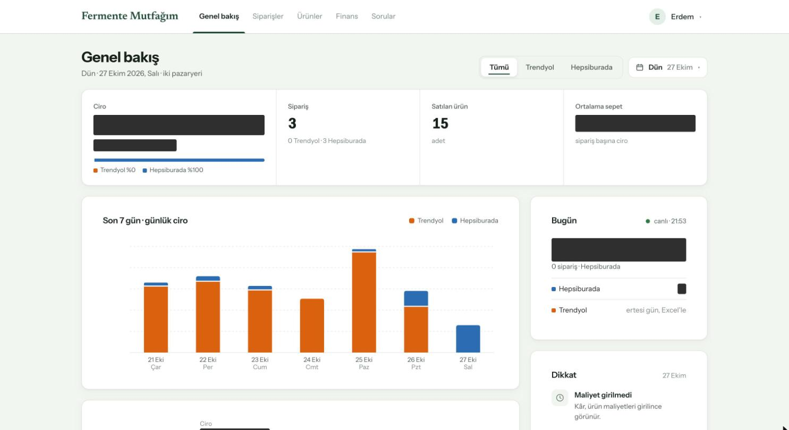
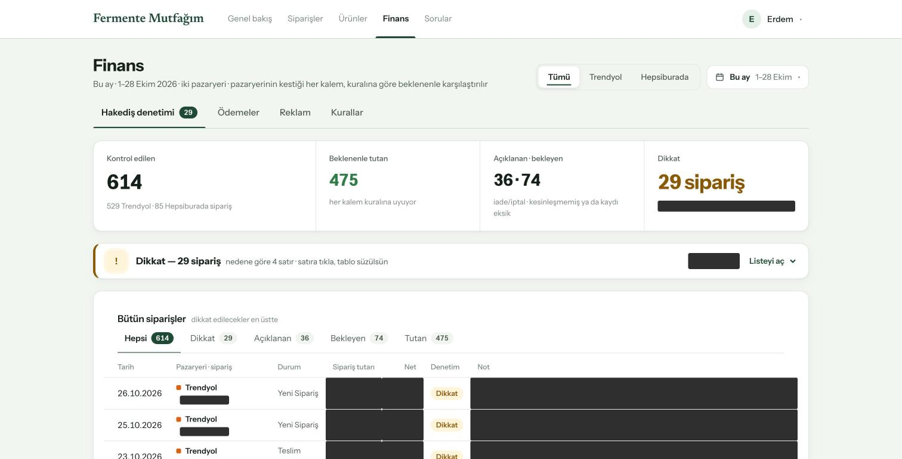
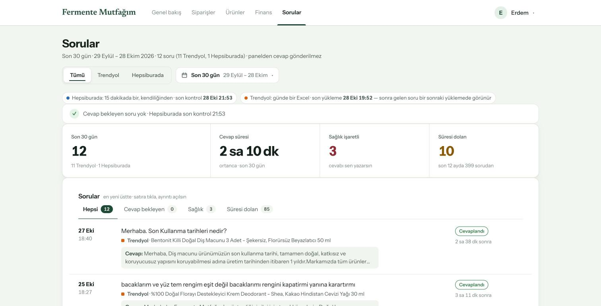
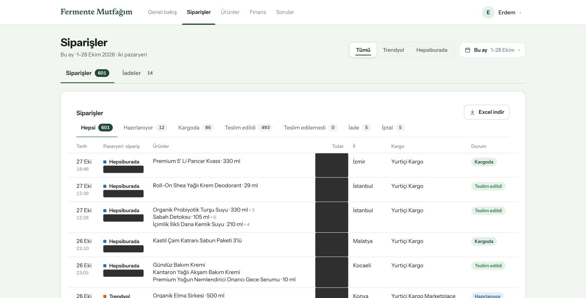
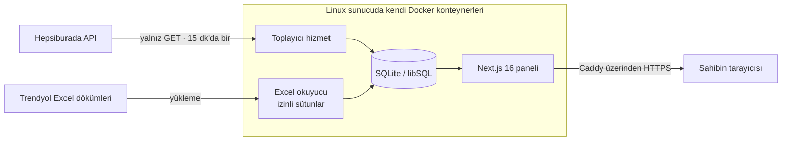

# Fermente Paneli

**Trendyol ve Hepsiburada'da satan bir marka için satış, kâr, hakediş denetimi ve müşteri sorusu paneli**

Black Wool Project · **Project Lead & Developer** · [English](README.md)

> **Bu depo hakkında.** Fermente Paneli, Black Wool'da **Fermente Mutfağım** için geliştirildi —
> Trendyol ve Hepsiburada'da satış yapan bir fermente gıda ve doğal bakım markası. Kaynak kodu gizli;
> bu bir vaka çalışmasıdır. Ekran görüntüleri 28 Ekim 2026'da çalışan sistemden çekildi; ciro, tutarlar
> ve sipariş numaraları düz kutuyla kapatıldı.

---

## Özet

| | |
|---|---|
| **Müşteri** | Fermente Mutfağım — fermente gıdalar ve doğal bakım ürünleri, iki pazaryerinde satış |
| **Ne** | **Yalnız okuyan** bir raporlama paneli: iki pazaryerinde de fiyata, stoğa ya da ilana hiç dokunmaz |
| **Ekranlar** | Genel bakış · Siparişler ve iadeler · Ürünler · Finans (hakediş denetimi, ödemeler, reklam, kurallar) · Müşteri soruları |
| **Veri girişi** | 15 dakikada bir Hepsiburada API'si · günlük Trendyol Excel dökümleri · ürün maliyeti şablonu |
| **Ölçek** | Bu ay 601 sipariş; hakediş denetimi her sipariş kalemini pazaryerinin kendi kesintisiyle karşılaştırıyor — Ekim'de 614 sipariş, 29'u dikkat |
| **Kod tabanı** | 21 model · uygulamada ~5.700 satır TypeScript · 371 commit · 11 sınav dosyası |

28 Ekim 2026'da depodan ve çalışan panelden ölçüldü.

---

## Sorun

Marka sahibi aynı ürünleri iki pazaryerinde satıyor; her birinin kendi satıcı paneli, kendi
raporları ve komisyon, kargo, hizmet bedeli ve reklam kesintisini hakedişten düşmenin kendi yolu
var. *Dün ne kadar sattık? Bankaya gerçekte ne yatacak? Pazaryeri kesmesi gerekeni mi kesti?
Bekleyen bir müşteri sorusu var mı?* gibi basit soruları cevaplamak, iki panele de girip tablolar
indirmek demekti.

Sahibin ihtiyacı **iki pazaryeri için tek bir ekran** ve pazaryerinin kendi kurallarına uymayan
kesintileri yakalamanın bir yoluydu — yeni bir araca mağazalarda herhangi bir şeyi değiştirme
yetkisi vermeden.

## Ne yaptım

| Ekran | Ne gösterir |
|---|---|
| **Genel bakış** | Seçilen gün için ciro, sipariş, satılan ürün ve ortalama sepet; pazaryerine göre bölünmüş 7 günlük ciro grafiği, canlı "bugün" kutusu ve dikkat listesi (ör. *ürün maliyetleri girilmedi*) |
| **Siparişler** | İki pazaryerinden bütün siparişler — ürünler, il, kargo firması ve durum; iadeler ayrı sekmede; Excel çıktısı |
| **Ürünler** | Ürünler ve içerikleriyle setler; kâr hesaplanabilsin diye indirilebilir maliyet şablonu |
| **Finans · hakediş denetimi** | Pazaryerinin yaptığı her kesinti, kendi kurallarının öngördüğüyle karşılaştırılır; uyuşmayan sipariş nedeniyle işaretlenir |
| **Finans · ödemeler ve reklam** | Paranın ne zaman ödeneceği ve dönem başına reklam gideri |
| **Müşteri soruları** | İki pazaryerinden sorular tek kutuda; ortanca cevap süresi, cevapsız süresi dolan sorular ve sahibin kendisinin cevaplaması için **sağlıkla ilgili diye işaretlenen** sorular |

### Yapımda

| Özellik | Durum |
|---|---|
| **Panelden soru cevaplama** | Şu an yapılıyor. Soru gelen kutusu sunucuda; sıradaki adım cevabı Hepsiburada ve Trendyol'a göndermek — iki API'nin cevap uçları resmî belgelerinden doğrulandı |
| **Sabah özet e-postası** | Sistemin panel ve toplayıcının yanındaki üçüncü parçası olarak planlandı: sahip her sabah 08:00'de dünün özetini alır, sayılar paneldekilerle birebir; yönetici kopyasında bir durum satırı olur (toplayıcının son çalışması, gelen sipariş ve soru sayısı) |

---

## Ekranlar

<table>
<tr>
<td width="50%"> <b>Hakediş denetimi.</b> Bu ay 614 sipariş denetlendi: 475'i her kurala uyuyor, 36'sı açıklanan (iade, iptal), 74'ü pazaryerinin kaydını bekliyor, 29'u dikkat istiyor. Tutarlar ve nedenler kapalı.</td>
<td width="50%"> <b>Müşteri soruları.</b> İki pazaryeri için tek kutu; her kaynağın verisinin ne kadar taze olduğu üstte yazıyor. Sağlıkla ilgili sorular kişisel cevap için işaretleniyor.</td>
</tr>
<tr>
<td colspan="2"> <b>Siparişler.</b> İki pazaryeri tek listede, durum sayılarıyla; sipariş numaraları ve tutarlar kapalı. Müşteri adı hiç saklanmıyor — aşağıya bakın.</td>
</tr>
</table>

---

## Mimari

Panel ve toplayıcı **aynı imajdan iki ayrı hizmet**: toplayıcı veriyi çeker, panel yalnız
veritabanını okur. Sunucuda bir gece yedeği çalışıyor.

---

## Mühendislik kararları

### 1. Yapısı gereği yalnız okur

Toplayıcı Hepsiburada'nın sipariş, muhasebe ve soru servislerinin yalnız `GET` uçlarını çağırıyor;
yazan, cevap veren ya da bildirim yapan hiçbir uç çağrılmıyor. Yanıt gövdeleri hiçbir zaman
günlüğe yazılmıyor — günlükte yalnız sayı, uç adı ve HTTP durumu var — ve API anahtarları ortamdan
okunuyor, hiçbir yere basılmıyor.

### 2. Müşteri kişisel verisi yok — iki kapıda birden

Veri modelinin ilk kuralı **alıcının kişisel verisinin veritabanına hiç girmemesi**. Toplayıcı her
siparişten yalnız kişisel olmayan alanları alıyor. Excel okuyucu yalnız açık bir izin listesinde
adı geçen sütunları yazıyor — bir dökümde beklenmeyen bir sütun çıkarsa onu saklamak yerine
yükleme **duruyor**; böylece değişmiş ya da bozuk bir döküm panele kişisel bir alan sızdıramıyor.
Yüklemeler tek işlemde yapılıyor: ya bütün satırlar ya hiçbiri.

### 3. Kâr pazaryerinin rakamıyla hesaplanıyor, bizimkiyle değil

Kâr = pazaryerinin ödeyeceği − ürün maliyeti − kargo. Kesintiler kurallardan **yeniden
hesaplanmıyor**; pazaryerinin kendi kayıtlarından geliyor (Trendyol'un sipariş kayıtları,
Hepsiburada'nın muhasebe servisi). Hepsiburada kaydını yayımlayana kadar hakediş, siparişin
komisyonundan tahmin edilip *kesinleşmedi* diye gösteriliyor. Bir ürünün maliyeti girilmemişse
sipariş, uydurulmuş bir kâr yerine *maliyet yok* gösteriyor. Hepsiburada'nın kesintisinde kargo
payı zaten varsa elle girilen kargo tutarı bir kez daha düşülmüyor — 3.070 Hepsiburada siparişinde
ölçüldü.

### 4. Denetim suçlamaz, açıklar

Her kesinti, pazaryerinin kendi kurallarının öngördüğü tutarla karşılaştırılıyor. Siparişler
*uyan*, *açıklanan* (iade ya da iptal), *kaydı bekleyen* ve *dikkat* diye ayrılıyor; işaretlenen
her sipariş nedenini sözle taşıyor. Panel yalnız gösteriyor; itiraz pazaryerinin kendi panelinden
yapılıyor.

### 5. Reklam gideri birikimli anlık görüntülerden

Trendyol'un reklam raporu kampanyanın başından indirme anına kadar birikimli ve tarih süzgeci
rakamı dönemlere bölmüyor (ölçüldü). Bu yüzden panel her yüklemeyi bir anlık görüntü olarak
saklıyor ve bir dönemin giderini *dönem bitmeden önceki son anlık − dönem başlamadan önceki son
anlık* diye hesaplıyor.

### 6. Sabitlenmiş bir veritabanı motoru

Prisma şema motorunu npm tedarik zincirinin dışından, kendi sunucusundan indiriyor. Bir sarmalayıcı
betik motorun SHA-256'sını sabitlenmiş değerle karşılaştırıyor ve tutmazsa **duruyor**; sonraki
her indirme denemesi ulaşılamaz bir adrese yönlendiriliyor, böylece sessiz değil yüksek sesle
düşüyor. Parolalar Node'un yerleşik scrypt'iyle özetleniyor — ek bağımlılık yok.

---

## Teknolojiler

| Katman | Teknoloji |
|---|---|
| Uygulama | Next.js 16, React 19, TypeScript, Prisma ORM 7, libSQL üzerinden SQLite |
| Veri girişi | Node toplayıcı (Hepsiburada REST, yalnız GET), izin listeli Python Excel okuyucu |
| Kalite | Node test çalıştırıcısı (`src/lib` altında 11 sınav dosyası), Excel okuyucu için Python birim sınavları |
| Dağıtım | Docker, GitHub Actions → GHCR, Caddy, gece yedeği |

---

## Rolüm

Paneli, markanın pazaryeri operasyonunu yöneten Black Wool'da geliştirdim: sahiple gereksinimler,
yapımdan önce onaylanan ekran tasarımları, veri modeli, toplayıcı ve Excel okuyucu, kâr ve hakediş
denetimi mantığı ve her biri etiketli bir sürüm olarak çıkan aşamalarla sunucuya dağıtım.

## Bu depoda olmayanlar

Kaynak kod, API anahtarları, panelin adresi, ciro, tutarlar, sipariş numaraları ve hiçbir müşteri verisi.
